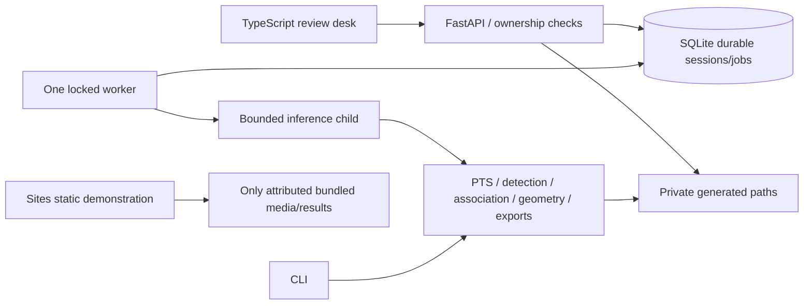

# BASELINE LAB

**A local-first tennis video analysis desk, and a computer vision engineering notebook.**

Upload one short singles rally, inspect its real presentation timestamps, calibrate four court corners, queue local analysis, review synchronized overlays and uncertain contact candidates, correct events, and export the evidence. Private processing runs on your machine. The hosted Site is a clearly labeled, precomputed public demonstration.

[Open the deployed demo](https://baseline-lab-massibrevo.maxbrevini.chatgpt.site) · [Public source](https://github.com/massibrevo/baseline-lab) · [Passed Linux CI](https://github.com/massibrevo/baseline-lab/actions/runs/41223338708)


The current update adds **RTMPose body skeletons, WASB temporal tennis-ball heatmaps, camera-adjusted court mapping and a transparent Shot Quality breakdown**. See [import/tracking changes](docs/upload-and-tracking-update.md), [pose](docs/pose.md) [Shot Quality](docs/shot-quality.md), [experimental km/h](docs/research-speed.md) and [the CourtSide trial](docs/courtside-trial.md).

This is an experimental research release, **not a validated tennis perception system**. Ball localization and distant-player pose can still fail, especially with occlusion, screen controls and multiple practice balls. A high observed-track coverage is not accuracy. See [executed verification](docs/verification.md), [provisional measurements](docs/evaluation-provisional.json), and [model selection](docs/model-selection.md).

## Run locally

Prerequisites: Git, **Python 3.12.14**, **uv 0.13.6**, Node **22.12.0+** and npm. No paid API keys or system FFmpeg are needed: the pinned imageio-ffmpeg wheel supplies FFmpeg. Download dependencies, the 14 MB person checkpoint, 54 MB pose graph and 6 MB tennis checkpoint once; processing then works offline.

```sh
git clone https://github.com/massibrevo/baseline-lab.git
cd baseline-lab
uv python install 3.12.14
uv sync --frozen
uv run baseline-lab setup-models
npm ci --prefix apps/web
npm run build --prefix apps/web
uv run baseline-lab serve
```

In a second terminal in the same checkout:

```sh
uv run baseline-lab worker
```

Open **http://127.0.0.1:8000**. Start with the bundled example. For your own clip, choose **Upload clip**, check the metadata, optionally click the **outside painted singles corners** in order: far left → far right → near right → near left, acknowledge recording suitability, and choose **Analyze clip**. Keep the API and worker running. Results survive restarts. The cookie identifies your private browser workspace; clearing it loses browser access. The app is intentionally bound to loopback.

The API exposes [OpenAPI](http://127.0.0.1:8000/docs). The frontend is static TypeScript/Vite, served by FastAPI locally; no separate frontend development server is needed.

## Supported envelope and tested media

Target workflow: singles, one continuous rally, approximately fixed elevated camera behind a baseline, visible court lines, adequate light. MP4/MOV, **5–30 s**, at most **100 MiB**, **4K source pixels (4096×2160 budget), automatically resized to a 1080p analysis budget**, **1800 decoded frames**, queue depth **5**, one isolated worker (MPS where available, CPU fallback), **900 s** bounded research-job timeout. Bounds are configurable with `.env` (copy `.env.example`). Content-length is required for multipart upload. Arbitrary URL ingestion is absent.

Executed codec/resolution/rate tests: H.264/yuv420p MP4 at **640×480 30 fps**, synthetic VFR **33.3/50 ms** intervals, **1280×720 30 fps** stabilized real singles and **1280×720 60 fps** original. MOV rotation is tested separately in the verification report. Other decodable codecs are accepted within bounds but are not an empirical accuracy guarantee. Browser review and annotated exports use H.264 MP4 with real PTS, normalized display rotation and no audio. No frame-index/24-fps speed calculations.

The real public example is an **oblique elevated-view stress study**, stabilized into first-frame coordinates; it is not a private baseline-camera benchmark. Its provenance is in [examples/README.md](examples/README.md). The synthetic fixture proves implementation behavior, not real-world accuracy.

## Reproduce analysis and exports

```sh
uv run baseline-lab analyze examples/commons-stabilized.mp4 data/example-result \
  --calibration examples/commons-calibration.json
uv run python scripts/evaluate.py data/example-result/result.json
```

Expected outputs: `annotated.mp4`, `review.mp4`, `result.json` (schema `1.4`), `raw-detections.json`, `events.csv`, `tracks.csv`, `live-metrics.csv`, `keypoints.csv`, `shot-quality.csv`, `shots.csv`, `ball-speed.csv`, `visual-trail.csv`. CSV columns name pixel, meter and second units. Raw detections, detected tracks, bounded interpolation and missing points remain distinct. Annotated video is the immutable processing snapshot; later event corrections are exported in the current JSON/CSV. Audio is deliberately omitted.

The measurement dock below the video shows **experimental ball km/h**, smoothed approximate player ground speed in km/h, cumulative observed path, body joints and reviewed-contact shot depth. Check normal 1× action timing when submitting a calibrated recording, or use CLI `--real-time-playback`. The constrained 3D flight fit is separate from validated speed, with assumptions, missing support and a sensitivity range. It does not use airborne ground-plane projection. A held speed is explicitly labeled as the last supported flight. Evidence/freshness badges and an inspector explain its support. Shot depth provides a direct bounce-review action instead of an empty card. See [research speed](docs/research-speed.md).

Player speed uses a robust trailing 0.5 s fit and temporal smoothing; path integrates that speed over contiguous observed links, retaining the raw footpoint sum in provenance. Joint overlays retain raw and One Euro filtered coordinates. The [continuous trail](docs/continuous-trail.md) uses a smooth single-colour cyan path with visual gap fill; raw measurements stay unchanged. Select observed-only or point mode to inspect the underlying support. The canvas follows decoded video frames; duplicate rendering is skipped and side panels update at a bounded rate. File heatmaps use three-frame batches; player detection uses Metal when available and local searches with periodic scene refreshes.

**Automatic stroke labels now use F3ED, a pretrained temporal tennis model.** Original/mirrored-view averaging and ambiguity checks produce provisional forehand, backhand, serve, overhead or volley labels. Automatic predictions and human reviews have separate controls and data arrays; saved timestamps are never recognition rules. Clip-boundary swings stay distinct from verified impacts. See [stroke recognition](docs/stroke-recognition.md). Shot Quality stays a transparent partial heuristic when independently measured speed, spin or bounce angle are absent. It does not automatically distinguish forced from unforced errors.

**Live camera mode runs locally.** Choose Live camera, enable video-only access, freeze a calibration frame, select four singles corners, confirm suitability and start. The preview stays live while the separate analyzed view shows matching capture frames, latency and skipped bursts. Batched heatmaps, person detection, checked flow and pose run in the isolated worker. Throughput depends on hardware and scene; zero latency and 30 fps inference are not guaranteed.

Freeze contact review, select the actual ground-contact point in the analyzed frame, and save it to calculate approximate shot depth. Stop capture to export sampled review/annotated MP4, JSON and live metrics CSV. Only processed frames are recorded; timing gaps remain visible. Limits: 60 seconds, 1280×720, 1800 processed samples, one worker, 10-second input-idle timeout, 4.5 MB request envelope, eight JPEGs per batch. Verified camera motion updates the court mapping per frame; failed registration leaves ground metrics unavailable at those timestamps. Physical camera/lens/permission behavior requires verification on the user's device; the executed streaming smoke test feeds real JPEG batches through the actual API/worker.

Validated ball 3D speed remains `null` with a reason; the experimental reconstruction is separate and not radar validated. All line classifications stay `uncertain` until independent error bounds exist. The four-point homography fit residual is **not** an accuracy measurement. Approximate player path distance sums only plausible contiguous observed segments, excludes gaps/jumps, and is not a complete rally distance. Airborne balls are never plotted as true ground-plane positions. Automatic court calibration is unavailable; the manual fallback works.

## Architecture



HTTP handlers validate uploads in an isolated decoder process and never run model inference. The durable worker atomically claims SQLite jobs, spawns one isolated inference child, reports actual per-stage frame counts, handles cancellation/timeouts, removes partial artifacts, and recovers interrupted jobs. No Redis or request-scoped background inference. Read [architecture and contracts](docs/architecture/system.md) and the [ADRs](docs/adr/).

## Privacy, licensing and hosting

Session ownership is checked on metadata, source, thumbnails, results, review edits, cancellation, deletion and artifact downloads. Signed HttpOnly SameSite cookies, CSRF header checks, restricted origins and loopback host checks protect the local app. Private files are never served as static assets or committed. Deletion immediately denies access, scrubs content metadata, cancels active work, and removes artifacts after the worker releases them. SQLite can retain historical bytes until compaction; backups are outside the app's deletion control. See [SECURITY.md](SECURITY.md).

Original code is MIT. Example media and derivatives are **CC BY-SA 4.0**, separately from the code license. PyTorch/torchvision code, pretrained-model terms, COCO image rights, OpenCV and FFmpeg notices remain separate. We do **not** redistribute model weights or claim their training data is MIT/BSD. The explicit model download and license context are in [MODEL_MANIFEST.yaml](MODEL_MANIFEST.yaml) and [THIRD_PARTY_NOTICES.md](THIRD_PARTY_NOTICES.md). No code from the reviewed Tennis-Analysis-System was copied. The MIT WASB HRNet architecture is vendored separately with its copyright and license; all checkpoints remain separately downloaded.

Sites hosts Workers/static assets, not native Python/OpenCV/Torch workers. The current Site deploys the public demo only. **Hosted private uploads and an HTTPS Python backend are not deployed or verified.** Do not expose the local API directly on the internet. [Remote integration steps and dated hosting constraints](docs/hosting.md) explain the remaining authentication, persistence, TLS and end-to-end checks. No paid compute/provider requests are enabled.

Optional Docker path (configuration supplied; execution depends on a running Docker daemon):

```sh
docker compose build
docker compose run --rm worker uv run --no-sync baseline-lab setup-models
docker compose up
```

The Compose volume is private local storage, and the exposed port binds to 127.0.0.1. Containers run as a non-root user with bounded CPU/memory. See verification for whether this path was actually executed.

## Verify and learn

```sh
uv run ruff check src scripts tests
uv run ruff format --check src scripts tests
uv run mypy src
uv run pytest -q -m 'not model'
uv run python scripts/generate-types.py
npm run build --prefix apps/web
# Explicit real-model check after setup-models:
uv run pytest -q -m model
```

CI runs lint, types, offline unit/integration and a bounded real-worker synthetic end-to-end smoke path, then builds the frontend. Model-download checks are opt-in. Agent profiles are instructions, not execution claims.

Read the seven [learning chapters](docs/learning/README.md), [reference review](docs/reference-review.md) and [ordered backlog](docs/backlog.md). Next milestone: independently label a rights-cleared private-baseline set, then evaluate a license-cleared temporal ball model against this deliberately weak baseline.

Troubleshooting: `worker_unavailable` means start the second terminal; `model_missing` means run `setup-models`; 422 media errors report limits or unsupported timestamps; camera cuts fail the job and require trimming/recalibration. Camera movement invalidates calibration and removes metric positions rather than reusing a stale homography. A model or codec failure is visible, never an empty success dashboard. If camera permission stays pending in the in-app browser, open the local URL in a camera-capable browser and grant camera access normally; do not disable browser protections. On macOS, PyAV/OpenCV may emit duplicate AVFoundation class warnings; Linux containers avoid those macOS libraries, and the executed macOS decode/encode path is documented in verification.
