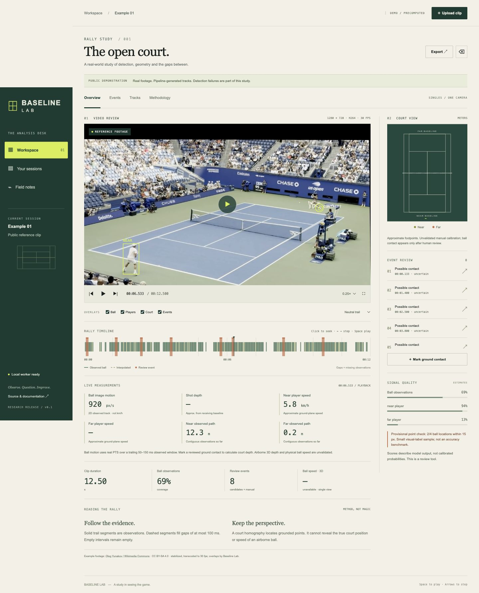
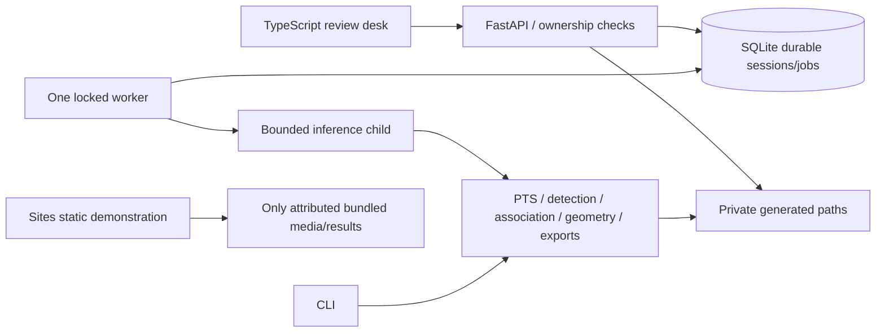

# BASELINE LAB

**A local-first tennis video analysis desk, and a computer vision engineering notebook.**

Upload one short singles rally, inspect its real presentation timestamps, calibrate four court corners, queue CPU analysis, review synchronized overlays and uncertain contact candidates, correct events, and export the evidence. Private processing runs on your machine. The hosted Site is a clearly labeled, precomputed public demonstration.

[Open the deployed demo](https://baseline-lab-massibrevo.maxbrevini.chatgpt.site) · [Public source](https://github.com/massibrevo/baseline-lab) · [Passed Linux CI](https://github.com/massibrevo/baseline-lab/actions/runs/41223338708)



This is an experimental first release, **not a validated tennis perception system**. The ball baseline produces false positives; the distant player is frequently missed. A high observed-track coverage is not accuracy. See [executed verification](docs/verification.md), [provisional measurements](docs/evaluation-provisional.json), and [model selection](docs/model-selection.md).

## Run locally

Prerequisites: Git, **Python 3.12.14**, **uv 0.13.6**, Node **22.12.0+** and npm. No paid API keys or system FFmpeg are needed: the pinned imageio-ffmpeg wheel supplies FFmpeg. Download dependencies and the 14 MB person weights once; processing then works offline.

```sh
git clone https://github.com/massibrevo/baseline-lab.git
cd baseline-lab
uv python install 3.12.14
uv sync --frozen
uv run baseline-lab setup-models
npm ci --prefix apps/web
npm run build --prefix apps/web
uv run baseline-lab serve
```

In a second terminal in the same checkout:

```sh
uv run baseline-lab worker
```

Open **http://127.0.0.1:8000**. Start with the bundled example. For your own clip, choose **Upload clip**, check the metadata, optionally click the **outside painted singles corners** in order: far left → far right → near right → near left, acknowledge recording suitability, and choose **Analyze clip**. Keep the API and worker running. Results survive restarts. The cookie identifies your private browser workspace; clearing it loses browser access. The app is intentionally bound to loopback.

The API exposes [OpenAPI](http://127.0.0.1:8000/docs). The frontend is static TypeScript/Vite, served by FastAPI locally; no separate frontend development server is needed.

## Supported envelope and tested media

Target workflow: singles, one continuous rally, approximately fixed elevated camera behind a baseline, visible court lines, adequate light. MP4/MOV, **5–30 s**, at most **100 MiB**, **1920×1080 pixels**, **1800 decoded frames**, queue depth **5**, one CPU worker, **300 s** job timeout. Bounds are configurable with `.env` (copy `.env.example`). Content-length is required for multipart upload. Arbitrary URL ingestion is absent.

Executed codec/resolution/rate tests: H.264/yuv420p MP4 at **640×480 30 fps**, synthetic VFR **33.3/50 ms** intervals, **1280×720 30 fps** stabilized real singles and **1280×720 60 fps** original. MOV rotation is tested separately in the verification report. Other decodable codecs are accepted within bounds but are not an empirical accuracy guarantee. Browser review and annotated exports use H.264 MP4 with real PTS, normalized display rotation and no audio. No frame-index/24-fps speed calculations.

The real public example is an **oblique elevated-view stress study**, stabilized into first-frame coordinates; it is not a private baseline-camera benchmark. Its provenance is in [examples/README.md](examples/README.md). The synthetic fixture proves implementation behavior, not real-world accuracy.

## Reproduce analysis and exports

```sh
uv run baseline-lab analyze examples/commons-stabilized.mp4 data/example-result \
  --calibration examples/commons-calibration.json
uv run python scripts/evaluate.py data/example-result/result.json
```

Expected outputs: `annotated.mp4`, `review.mp4`, `result.json` (schema `1.1`), `raw-detections.json`, `events.csv`, `tracks.csv`. CSV columns name pixel, meter and second units. Raw detections, detected tracks, bounded interpolation and missing points remain distinct. Annotated video is the immutable processing snapshot; later event corrections are exported in the current JSON/CSV. Audio is deliberately omitted.

The live playback panel updates at each video PTS: **ball image motion in px/s**, approximate near/far player ground speed in km/h, observed cumulative path in meters, and court shot depth after manual contact review. Derived samples are included in version 1.1 JSON and `live-metrics.csv`; missing/interpolated observations do not produce invented speed. A trailing 50–150 ms observation window smooths derivatives. Shot depth is the signed distance inside the receiving baseline (negative beyond it), an approximate grounded-contact measurement.

**Physical ball speed in km/h and airborne 3D depth remain unavailable.** The app does not convert image pixels through a ground homography and call it 3D motion. “Live” here means synchronized metrics during recorded-video playback, not real-time camera capture/inference. Live camera streaming and calibrated 3D reconstruction are separate future workflows. Ball 3D speed is `null` with a reason. All line classifications stay `uncertain` until independent error bounds exist. The four-point homography fit residual is **not** an accuracy measurement. Approximate player path distance sums only plausible contiguous observed segments, excludes gaps/jumps, and is not a complete rally distance. Airborne balls are never plotted as true ground-plane positions. Automatic court calibration is unavailable; the manual fallback works.

## Architecture



HTTP handlers validate uploads in an isolated decoder process and never run model inference. The durable worker atomically claims SQLite jobs, spawns one isolated inference child, reports actual per-stage frame counts, handles cancellation/timeouts, removes partial artifacts, and recovers interrupted jobs. No Redis or request-scoped background inference. Read [architecture and contracts](docs/architecture/system.md) and the [ADRs](docs/adr/).

## Privacy, licensing and hosting

Session ownership is checked on metadata, source, thumbnails, results, review edits, cancellation, deletion and artifact downloads. Signed HttpOnly SameSite cookies, CSRF header checks, restricted origins and loopback host checks protect the local app. Private files are never served as static assets or committed. Deletion immediately denies access, scrubs content metadata, cancels active work, and removes artifacts after the worker releases them. SQLite can retain historical bytes until compaction; backups are outside the app's deletion control. See [SECURITY.md](SECURITY.md).

Original code is MIT. Example media and derivatives are **CC BY-SA 4.0**, separately from the code license. PyTorch/torchvision code, pretrained-model terms, COCO image rights, OpenCV and FFmpeg notices remain separate. We do **not** redistribute model weights or claim their training data is MIT/BSD. The explicit model download and license context are in [MODEL_MANIFEST.yaml](MODEL_MANIFEST.yaml) and [THIRD_PARTY_NOTICES.md](THIRD_PARTY_NOTICES.md). No reference-repository code was copied.

Sites hosts Workers/static assets, not native Python/OpenCV/Torch workers. The current Site deploys the public demo only. **Hosted private uploads and an HTTPS Python backend are not deployed or verified.** Do not expose the local API directly on the internet. [Remote integration steps and dated hosting constraints](docs/hosting.md) explain the remaining authentication, persistence, TLS and end-to-end checks. No paid compute/provider requests are enabled.

Optional Docker path (configuration supplied; execution depends on a running Docker daemon):

```sh
docker compose build
docker compose run --rm worker uv run --no-sync baseline-lab setup-models
docker compose up
```

The Compose volume is private local storage, and the exposed port binds to 127.0.0.1. Containers run as a non-root user with bounded CPU/memory. See verification for whether this path was actually executed.

## Verify and learn

```sh
uv run ruff check src scripts tests
uv run ruff format --check src scripts tests
uv run mypy src
uv run pytest -q -m 'not model'
uv run python scripts/generate-types.py
npm run build --prefix apps/web
# Explicit real-model check after setup-models:
uv run pytest -q -m model
```

CI runs lint, types, offline unit/integration and a bounded real-worker synthetic end-to-end smoke path, then builds the frontend. Model-download checks are opt-in. Agent profiles are instructions, not execution claims.

Read the seven [learning chapters](docs/learning/README.md), [reference review](docs/reference-review.md) and [ordered backlog](docs/backlog.md). Next milestone: independently label a rights-cleared private-baseline set, then evaluate a license-cleared temporal ball model against this deliberately weak baseline.

Troubleshooting: `worker_unavailable` means start the second terminal; `model_missing` means run `setup-models`; 422 media errors report limits or unsupported timestamps; camera cuts fail the job and require trimming/recalibration. Camera movement invalidates calibration and removes metric positions rather than reusing a stale homography. A model or codec failure is visible, never an empty success dashboard. On macOS, PyAV/OpenCV may emit duplicate AVFoundation class warnings; Linux containers avoid those macOS libraries, and the executed macOS decode/encode path is documented in verification.
